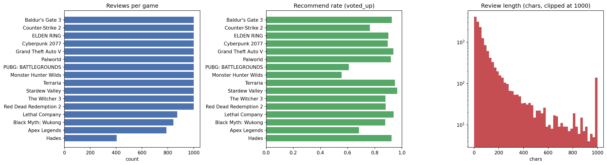
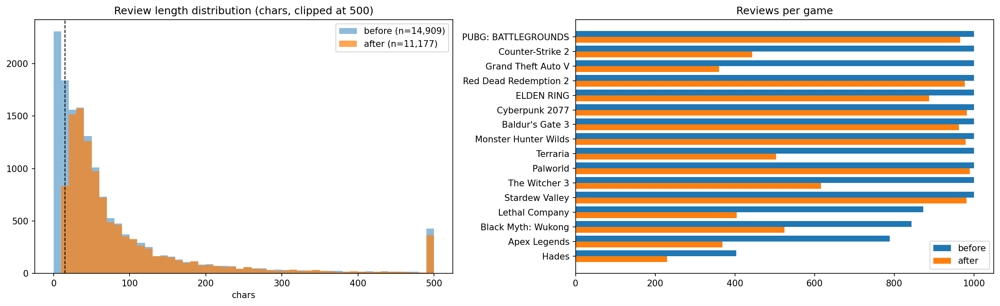
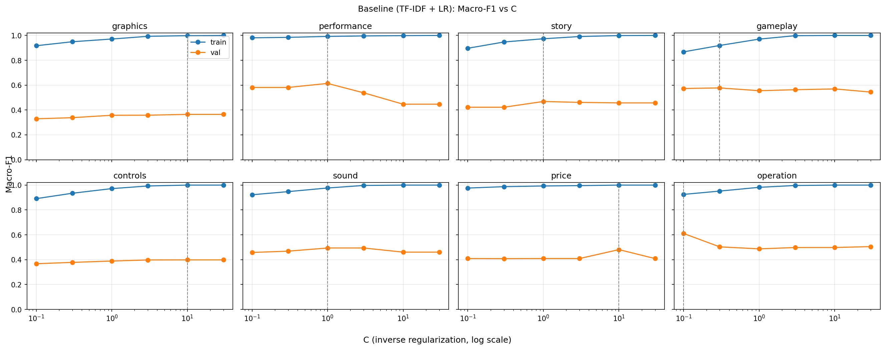
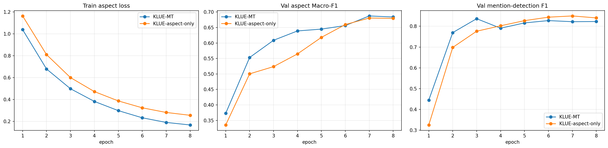
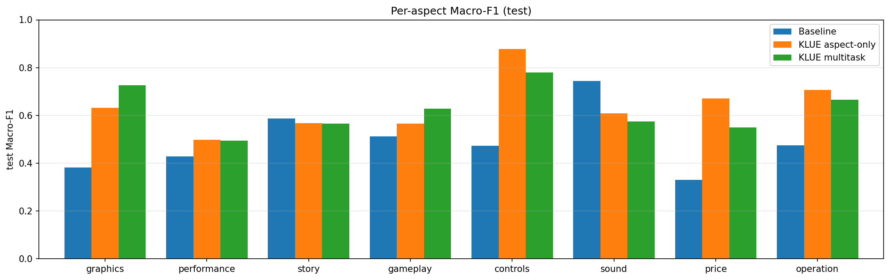
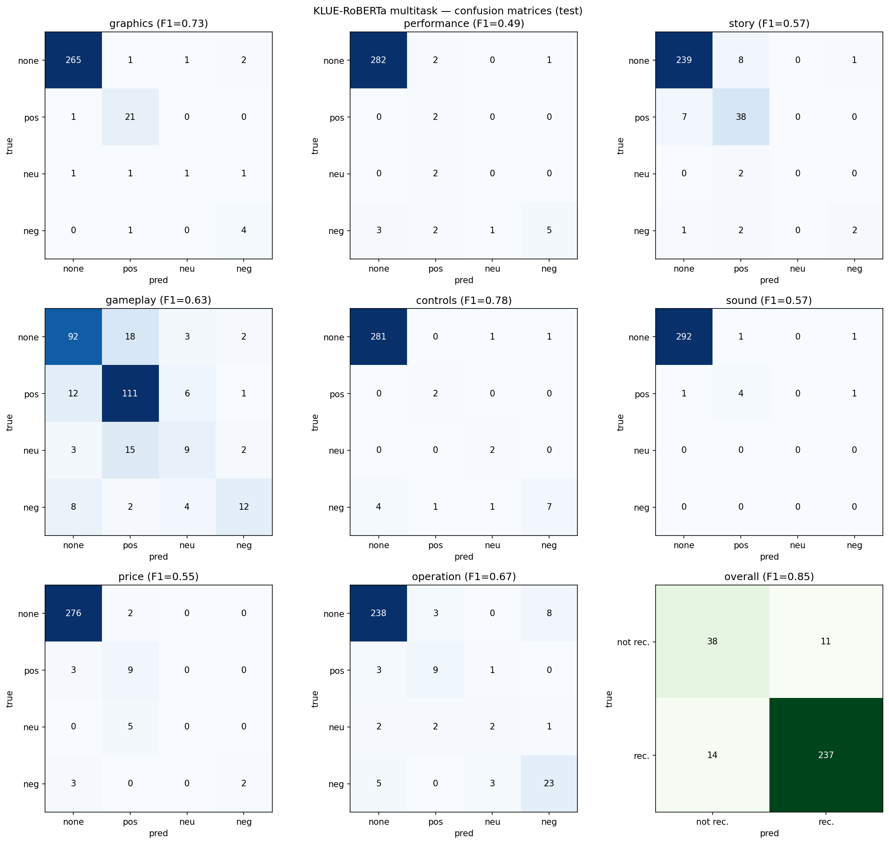

# 🎮 Steam 한국어 리뷰 속성별 감성 분석 (ABSA)

> Steam 리뷰 한 건을 <strong>8개 속성</strong>(그래픽·최적화·스토리·게임성·조작감·사운드·가격·운영)별 <strong>미언급 / 긍정 / 보통 / 부정</strong>과 <strong>종합 평가(추천/비추천)</strong>로 분해하는 모델을 직접 학습하고, 게임 단위 평판 분석 서비스로 구현했습니다.

### 평가 기준 대응표

| 평가 항목 | 위치 |
|---|---|
| A1 4W · 차별점 / A2 정량 목표 | [## 1](#1-문제-정의) |
| B1 출처·라이선스·규모·클래스 분포 / B4 데이터 선정 이유 | [## 2](#2-데이터) |
| B2 전처리 3가지 이상·전후 비교 / B3 분할 비율·Seed·테스트 분리 | [## 3](#3-데이터-전처리) |
| C1 모델 2개 + 학습 로그 / C2 모델 선정 이유 | [## 4](#4-모델) |
| C3 테스트 지표 2개 이상 비교·최종 선택 / C4 학습곡선·혼동행렬·오류 사례 | [## 4](#4-모델) 학습 로그, [## 5](#5-평가-결과) |
| D1 직접 학습한 모델 로드 / D3 캡처·사용 안내·예외 처리 | [## 6](#6-서비스-프로토타입) |
| D2 공개 URL | [## 7](#7-배포) |
| E1 Public 저장소·필수 섹션 / E2 requirements·환경·실행 방법·가중치 위치 | [## 0](#0-프로젝트-정보), [## 8](#8-실행-방법) |
| F1 PMI / F2 문제 해결 사례 / F3 개선 계획 | [## 9](#9-lessons-learned) |

---

## 0. 프로젝트 정보

| 항목 | 내용 |
|---|---|
| 학번 / 이름 | 202235210 / 김남엽 |
| 데모 URL | https://huggingface.co/spaces/nabib-kim/steam-ko-review-analyzer (배포 진행 중 — 7장 참고) |
| GitHub URL | https://github.com/NabibKim/ML |
| 모델 가중치 | https://huggingface.co/nabib-kim/steam-ko-absa-klue |
| 최종 모델 | KLUE-RoBERTa 멀티태스크 (속성 8 + 종합 평가 헤드) — 테스트 속성 평균 Macro-F1 <strong>0.623</strong>, 종합 평가 Macro-F1 <strong>0.851</strong> |

---

## 1. 문제 정의

### 4W

| | 내용 |
|---|---|
| **Who** | 게임 구매를 고민하는 게이머, 유저 피드백을 분석해야 하는 인디·중소 개발사 |
| **What** | 자유 형식의 한국어 리뷰를 **속성별 평가**로 구조화 — "그래픽은 좋은데 최적화가 엉망"을 *그래픽 긍정 / 최적화 부정*으로 |
| **When** | 구매 직전(내 PC로 돌아갈까? 가격 값을 할까?), 대규모 패치 직후(최적화·버그가 고쳐졌나?) |
| **Why** | Steam은 **추천 비율 하나**만 보여줍니다. "이 게임 최적화 어때?"를 알려면 리뷰 수백 건을 직접 읽어야 합니다. |

### 기존 서비스 대비 차별점

| 기존 | 이 프로젝트 |
|---|---|
| Steam 평가 요약: 추천 비율 한 개 숫자("대체로 긍정적 84%") | 속성 8개 각각의 언급률과 긍정·보통·부정 비율 |
| 일반 감성 분석: 리뷰 전체를 긍정/부정 하나로 분류 | 한 리뷰 안에서 속성마다 다른 감성을 분리 (ABSA) |
| 영어 중심 ABSA 데이터셋·모델 | **한국어 게임 리뷰** 전용, 게임 은어(발적화·혜자·핵쟁이·노가다)를 포함한 데이터로 학습 |
| — | 속성이 하나도 언급되지 않은 총평·은유형 리뷰("인생겜", "시간 순삭")는 **종합 평가 헤드**로 호불호를 표시 |

### 정량 목표

| 지표 | 목표 | 결과 |
|---|---|---|
| **주지표: 테스트 속성 평균 Macro-F1** | ≥ 0.70 | 0.623 (속성 단독 모델 0.641) — 미달, [5장](#5-평가-결과)에서 원인 분석 |
| 보조: 언급 감지 F1 (미언급 vs 언급) | ≥ 0.80 | **0.825 (달성)** |
| 보조: 종합 평가 Macro-F1 | ≥ 0.80 | **0.851 (달성)** |
| 베이스라인 대비 개선 | 주지표 +0.10 이상 | **+0.131 (달성)** |

---

## 2. 데이터

### 데이터 출처

| 항목 | 내용 |
|---|---|
| 출처 | Steam Store 공개 리뷰 엔드포인트 `https://store.steampowered.com/ajaxappreviews/{appid}?json=1&language=koreana` (API 키 불필요) — [`notebooks/01_collect.ipynb`](notebooks/01_collect.ipynb) |
| 수집 일시 | 2026-11 |
| 종합 평가 라벨 | 리뷰 작성자가 직접 누른 **추천 버튼(`voted_up`)** — 추가 라벨링 불필요 |
| 속성 라벨 | 라벨링 가이드([`docs/labeling_guide.md`](docs/labeling_guide.md))에 따라 <strong>LLM이 라벨링</strong>(2,000건) — 학습과 평가에 <strong>같은 기준</strong>을 쓰기 위해 테스트셋도 LLM 라벨 사용. 사람 검수는 시도 후 참고 자료로만 활용(5장 ④, 9장) |

### 라이선스

| 항목 | 내용 |
|---|---|
| 라이선스 | Steam Subscriber Agreement · Steam Web API 이용약관에 따른 공개 데이터. **비상업적 학술 목적**으로만 사용, 원문 재배포 최소화(원본 리뷰 파일은 저장소에 올리지 않음) |
| 개인정보 | 작성자 steamid·닉네임·프로필·아바타는 **수집 단계에서 저장하지 않음** (플레이타임 등 수치만 보존) |

### 데이터 규모 및 구성

장르가 다른 **16개 게임**(배틀로얄·FPS·오픈월드·소울라이크·CRPG·시뮬레이션·로그라이크 등)에서 게임당 최대 1,000건.

| 단계 | 건수 |
|---|---:|
| 수집 원본 | 14,909 (추천 비율 84.8%, 길이 중앙값 41자) |
| 정제 후 | **11,177** |
| 속성 라벨링 표본 | 2,000 (무작위 1,000 + 희소 속성 보강 1,000) |



**속성 라벨 분포 (2,000건)** — 대부분의 칸이 "미언급"인 극단적 불균형

| 속성 | 미언급 | 긍정 | 보통 | 부정 | 테스트 언급 수 |
|---|---:|---:|---:|---:|---:|
| 그래픽 | 1,620 | 290 | 40 | 50 | 31 |
| 최적화 | 1,742 | 106 | 33 | 119 | 15 |
| 스토리 | 1,502 | 398 | 46 | 54 | 52 |
| 게임성 | 703 | 914 | 190 | 193 | 185 |
| 조작감 | 1,714 | 72 | 63 | 151 | 17 |
| 사운드 | 1,825 | 155 | 8 | 12 | **6** |
| 가격 | 1,800 | 109 | 36 | 55 | 22 |
| 운영 | 1,566 | 92 | 59 | 283 | 51 |

**게임성 라벨과 종합 평가(추천 버튼)의 관계** — 두 라벨은 겹치지만 같지 않습니다.

| 게임성 \ 종합 | 비추천 | 추천 |
|---|---:|---:|
| 긍정 | 13 | 901 |
| 보통 | 21 | 169 |
| 부정 | 160 | 33 |
| **미언급** | **200** | **503** |

게임성이 미언급인 703건(35%)은 속성 정보가 전혀 없는 총평·은유형 리뷰입니다. 이 리뷰들의 호불호를 담기 위해 종합 평가 출력을 추가했습니다. "게임 자체는 재밌는데 핵쟁이 때문에…"처럼 **게임성 긍정 + 비추천**인 리뷰도 있습니다.

### 데이터 선정 이유

1. **실제 문제와 직결:** 게이머가 실제로 읽는 데이터 그 자체이며, 서비스에서 같은 엔드포인트로 최신 리뷰를 가져와 바로 분석할 수 있습니다.
2. **속성이 자연스럽게 섞인 텍스트:** 게임 리뷰는 한 문장에 그래픽·최적화·가격이 함께 나오고 감성이 서로 다른 경우가 많아 ABSA 과제에 적합합니다.
3. **약지도 라벨이 공짜로 존재:** 추천 버튼이 11,177건 전부에 있어 종합 평가를 추가 비용 없이 학습할 수 있습니다.
4. **한국어 ABSA 공개 데이터의 부재:** AI허브·공공데이터포털에 한국어 게임 리뷰 속성 라벨 데이터가 없어 직접 구축했습니다.
5. **다양성:** 장르를 고르게 섞어 특정 장르 어휘에 과적합되지 않도록 했습니다(추천 비율도 56%~97%로 다양).

---

## 3. 데이터 전처리

[`notebooks/02_preprocess.ipynb`](notebooks/02_preprocess.ipynb), 함수는 [`src/preprocess.py`](src/preprocess.py) — **서비스(app.py)에서도 같은 함수를 사용**해 학습·추론 입력 분포를 일치시킵니다.

### 전처리 기법 (3가지 이상 — 5단계 구현)

| 단계 | 기법 | 이유 | 대상 / 결과 |
|---|---|---|---|
| ① | **마크업 제거** — Steam BBCode(`[h1]`, `[spoiler]`), HTML 태그, URL | 내용과 무관한 서식 토큰 | BBCode 126건, HTML 19건, URL 15건 |
| ② | **문자 정규화** — 유니코드 NFC, 아스키아트·이모지 제거, 같은 문자 3회 이상 → 2회(`ㅋㅋㅋㅋ`→`ㅋㅋ`, 숫자는 보존: "1000시간"), 공백 정리 | 표기 변형을 줄여 어휘 희소성 완화 | 반복 문자 1,853건 등 **5,228건(46.8%)의 텍스트가 변경**, 평균 길이 95.1 → 92.6자 |
| ③ | **중복 제거** | "good"(141회), "갓겜"(74회) 같은 복붙 리뷰가 학습·평가를 왜곡 | −1,062건 |
| ④ | **언어 필터** — 한글 비율 ≥ 0.5 | 한국어 모델 학습 대상 외 리뷰 제거 | −557건 |
| ⑤ | **길이 필터** — 15자 이상 2,000자 이하 | "존잼"처럼 속성 판단 근거가 없는 초단문, 극단적 장문 제거 | −2,113건 |

### 전처리 전·후 비교

| 단계 | 남은 건수 | 원본 대비 |
|---|---:|---:|
| 원본 | 14,909 | 100.0% |
| ③ 중복 제거 후 | 13,847 | 92.9% |
| ④ 언어 필터 후 | 13,290 | 89.1% |
| ⑤ 길이 필터 후 | **11,177** | 75.0% |

| 기법 | 전 | 후 |
|---|---|---|
| BBCode 제거 | `[h2][b]🏆도전과제 100% 달성 완료[/b][/h2] [b] 근 10년간…` | `도전과제 100% 달성 완료 근 10년간…` |
| 반복 문자 축약 | `…개 얼탱이 없네 ㅋㅋㅋㅋ` / `기대합니다만.......실현 가능성은 글쎄,,,,,` | `…개 얼탱이 없네 ㅋㅋ` / `기대합니다만..실현 가능성은 글쎄,,` |



### Train / Validation / Test 분할

[`notebooks/03_sampling_split.ipynb`](notebooks/03_sampling_split.ipynb)

| 항목 | 내용 |
|---|---|
| **Seed** | **42** (샘플링·분할·학습 모두 동일) |
| **분할 비율** | 무작위 표본 1,000건 → **Train 50% : Validation 20% : Test 30%** (500 : 200 : 300) |
| **테스트셋 분리** | Test 300건은 C 튜닝·조기 종료·모델 선택 어디에도 쓰지 않고 최종 평가에만 사용 |

| | 속성 과제 | 종합 평가 과제 |
|---|---|---|
| **Train** | 1,500 (무작위 500 + 희소 속성 보강 1,000) | 10,677 (정제 데이터 중 Val·Test 제외 전부) |
| **Validation** | 200 (무작위) | 200 (속성 Val과 같은 리뷰) |
| **Test** | **300 (무작위, 학습·튜닝에 미사용)** | 300 (속성 Test와 같은 리뷰) |

- 정제 데이터 11,177건에서 무작위 1,000건을 뽑아 **Train 500 / Val 200 / Test 300**으로 나눴습니다.
- 사운드·조작감처럼 언급이 드문 속성은 키워드로 1,000건을 추가로 뽑아 **Train에만** 넣었습니다(보강). Val·Test는 무작위 표본만 사용해 **실제 분포**를 유지했습니다.
- 테스트 라벨도 학습 데이터와 같은 기준의 **LLM 라벨**을 사용했습니다. 사람 검수 시도([`notebooks/03b_verify_test.ipynb`](notebooks/03b_verify_test.ipynb))는 기준이 일정하지 않아 최종 평가에서 제외하고 참고로만 보고합니다(5장 ④, 9장).

---

## 4. 모델

두 모델 모두 **직접 학습**했습니다. 평가 코드는 [`src/absa.py`](src/absa.py) 하나를 공유해 같은 분할·같은 지표로 비교합니다.

### 베이스라인 — TF-IDF + 로지스틱 회귀 (Scratch)

[`notebooks/04_baseline.ipynb`](notebooks/04_baseline.ipynb)

| 항목 | 내용 |
|---|---|
| 특징 | TF-IDF **글자 n-gram (2~4, 단어 경계 기준)**, 최대 50,000개, sublinear TF |
| 분류기 | 속성별 로지스틱 회귀 8개(4클래스) + 종합 평가 로지스틱 회귀 1개, `class_weight="balanced"` |
| 튜닝 | 속성마다 C ∈ {0.1, 0.3, 1, 3, 10, 30}을 **Validation Macro-F1**로 선택 |
| 선정 이유 | 한국어는 조사·어미가 붙어 단어 단위가 잘게 깨지므로 형태소 분석기 없이도 강건한 글자 n-gram을 사용. 빠르고 해석 가능한 **고전 ML의 상한선**을 확인하는 기준점 |



### 제안 모델 — KLUE-RoBERTa 멀티태스크 (Fine-tuning)

[`notebooks/05_transformer.ipynb`](notebooks/05_transformer.ipynb), 모델 클래스 [`src/absa_model.py`](src/absa_model.py)

```
리뷰 → klue/roberta-base 인코더 → [CLS] ─┬→ 속성 헤드 × 8 (각 4클래스: 미언급/긍정/보통/부정)
                                          └→ 종합 평가 헤드 (추천/비추천)
```

| 항목 | 내용 |
|---|---|
| 사전학습 모델 | `klue/roberta-base` (한국어 RoBERTa, KLUE 벤치마크 공식 모델) |
| 학습 방식 | **파인튜닝** — 인코더 전체 + 헤드 9개를 함께 학습 |
| 손실 | 속성별 가중 교차엔트로피 평균 + 0.5 × 종합 평가 교차엔트로피 |
| 클래스 불균형 | 속성마다 √(역빈도) 클래스 가중치 (예: 사운드 미언급 0.15, 보통 1.91) |
| 멀티태스크 데이터 | 매 epoch 속성 Train 1,500건 + 종합 평가 전용 리뷰 3,000건(10,677건 중 무작위) |
| 하이퍼파라미터 | max_len 256, batch 32, epoch 8(조기 종료 patience 3), lr 인코더 3e-5 / 헤드 1e-4, warmup 10%, fp16 |
| 모델 선택 | 매 epoch **Validation 속성 평균 Macro-F1** 최고 시점 저장 |
| 학습 환경 | Colab Tesla T4, epoch당 약 1분 (멀티태스크 8 epoch + 속성 단독 8 epoch, 총 약 10분) |

**비교 실험(ablation):** 같은 설정에서 종합 평가 과제를 뺀 **속성 단독 KLUE 모델**도 학습해 멀티태스크의 효과를 분리했습니다.

### 학습 방식

| 모델 | 학습 방식 | 설명 |
|---|---|---|
| 베이스라인 TF-IDF + LR | **Scratch** | 사전학습 없이 학습 데이터만으로 특징(TF-IDF)과 분류기를 처음부터 학습 |
| 제안 KLUE-RoBERTa 멀티태스크 | **Fine-tuning** | 사전학습된 `klue/roberta-base` 인코더 전체와 새로 붙인 헤드 9개를 함께 미세조정 |
| 비교 실험 KLUE-RoBERTa 속성 단독 | **Fine-tuning** | 위와 같되 종합 평가 과제 제외 |

### 모델 선정 이유

1. **문맥 의존성:** "그래픽은 예쁜데 최적화가…"처럼 한 문장 안에서 속성마다 감성이 갈리고, 반어("최적화 진짜 '훌륭'하네요 30프레임")가 흔합니다. 표면 n-gram만 보는 베이스라인은 이를 구분하지 못하므로, 문맥을 양방향으로 읽는 Transformer 인코더를 선택했습니다.
2. **한국어 전용 사전학습:** 다국어 모델보다 한국어 토큰화 효율과 성능이 좋습니다. base 크기라 T4에서 10분 안에 학습됩니다.
3. **공유 인코더 + 멀티헤드:** 속성 8개를 모델 하나로 처리해 서비스 추론이 한 번에 끝나고, 데이터가 많은 종합 평가 과제(10,677건)가 데이터가 적은 속성 헤드(1,500건)에 감성 표현을 전이해 줄 것으로 기대했습니다.

### 학습 로그



| epoch | 멀티태스크 train loss | 멀티태스크 val Macro-F1 | 속성 단독 val Macro-F1 |
|---:|---:|---:|---:|
| 1 | 1.283 | 0.373 | 0.335 |
| 2 | 0.835 | 0.553 | 0.500 |
| 4 | 0.478 | 0.639 | 0.565 |
| 6 | 0.303 | 0.656 | 0.660 |
| 7 | 0.250 | **0.687** ★ | **0.681** ★ |
| 8 | 0.213 | 0.684 | 0.680 |

전체 로그: [`results/klue_train_log.csv`](results/klue_train_log.csv), [`results/baseline_train_log.csv`](results/baseline_train_log.csv)

---

## 5. 평가 결과

### 평가지표 비교표 (테스트셋 300건)

| 모델 | 학습 방식 | **속성 Macro-F1** | Accuracy | 언급 감지 F1 | 종합 Macro-F1 | 종합 Accuracy |
|---|---|---:|---:|---:|---:|---:|
| Baseline: TF-IDF + LR | Scratch | 0.492 | 0.890 | 0.592 | 0.829 | 0.907 |
| KLUE-RoBERTa (속성 단독) | Fine-tuning | **0.641** | 0.928 | **0.834** | – | – |
| **KLUE-RoBERTa 멀티태스크 (서비스 탑재)** | Fine-tuning | 0.623 | **0.929** | 0.825 | **0.851** | **0.917** |

- 테스트 라벨: 학습 데이터와 같은 기준의 **LLM 라벨** (사람 검수 시도는 ④ 참고)
- **속성 Macro-F1:** 속성별 4클래스 Macro-F1의 평균. 정답·예측 어디에도 없는 클래스는 평균에서 제외
- **Accuracy:** 2,400칸(300건 × 8속성)의 칸 단위 정확도 — 대부분의 칸이 "미언급"이라 높게 나오므로 **주지표로 쓰지 않음**
- **언급 감지 F1:** 미언급 vs 언급(긍정·보통·부정)의 이진 F1

### 속성별 비교



| 속성 | Baseline | KLUE 멀티태스크 | 변화 |
|---|---:|---:|---:|
| 그래픽 | 0.382 | **0.726** | +0.344 |
| 최적화 | 0.429 | **0.494** | +0.066 |
| 스토리 | **0.587** | 0.566 | −0.020 |
| 게임성 | 0.512 | **0.629** | +0.117 |
| 조작감 | 0.474 | **0.781** | +0.307 |
| 사운드 | **0.745** | 0.574 | −0.171 * |
| 가격 | 0.331 | **0.550** | +0.219 |
| 운영 | 0.475 | **0.666** | +0.191 |

\* 사운드는 테스트 언급이 6건뿐이고 모두 긍정입니다. 베이스라인은 언급 자체를 거의 못 찾아 평균에 들어가는 클래스가 적어 Macro-F1이 부풀려졌습니다. 언급 감지 F1은 **0.50 → 0.77**로 KLUE가 훨씬 낫습니다. 희소 속성은 Macro-F1만으로 판단하면 안 된다는 근거입니다.

### 최종 모델 선정 근거

<strong>주지표 최고 모델은 KLUE 속성 단독(0.641)</strong>이지만, <strong>서비스에는 KLUE 멀티태스크(0.623)</strong>를 탑재했습니다.

1. **두 KLUE 모델 모두 베이스라인을 크게 앞섬:** 속성 Macro-F1 +0.13~0.15, 언급 감지 F1 +0.23~0.24. 문맥 모델 채택의 근거는 분명합니다.
2. **두 KLUE 모델의 차이(0.018)는 실행 간 편차 수준:** 같은 설정으로 두 번 학습했을 때 1차 실행에서는 멀티태스크가 0.645로 더 높았고, 2차 실행(이 표)에서는 속성 단독이 높았습니다. 시드 1회 실험으로는 멀티태스크의 효과를 결론 내릴 수 없습니다.
3. **서비스 요구사항:** 속성이 전혀 언급되지 않은 리뷰(테스트 예측 기준 62건, 21%)에도 호불호를 보여주려면 **종합 평가 헤드**가 필요하고, 이를 가진 모델은 멀티태스크뿐입니다(종합 Macro-F1 0.851, 비추천 F1 0.752 — 베이스라인 0.714보다 높음).

### 분석 그래프 및 결과 분석

학습곡선은 [## 4 학습 로그](#학습-로그), 혼동행렬·클래스별 재현율·오류 사례는 아래와 같습니다.

**① 혼동행렬** — 오류는 대부분 "미언급 ↔ 언급" 경계에서 발생



| 오답 방향 (정답 → KLUE 예측) | 칸 수 |
|---|---:|
| 미언급 → 긍정 | 35 |
| 보통 → 긍정 | 27 |
| 긍정 → 미언급 | 27 |
| 부정 → 미언급 | 24 |
| 미언급 → 부정 | 16 |

**② 클래스별 재현율** — "보통"이 가장 어려움

| 클래스 (테스트 칸 수) | Baseline | KLUE 멀티태스크 |
|---|---:|---:|
| 긍정 (232) | 0.62 | **0.84** |
| 보통 (51) | 0.20 | **0.27** |
| 부정 (96) | 0.41 | **0.57** |

"보통"은 학습 데이터에서도 가장 적고(속성당 8~190건), 사람이 봐도 긍정·부정과 경계가 모호합니다. 주지표가 목표(0.70)에 못 미친 가장 큰 원인입니다.

**③ 오류 사례**

| 리뷰 (요약) | 정답(LLM) | Baseline | KLUE | 해석 |
|---|---|---|---|---|
| "…니가와라 공룡 권법… 구질구질하게 싸워서 이겨도… 이전작에 비해 많이 달라졌고 재밌어졌다. 언제나 좆같았다고 다음에 또 보자" | 게임성 보통 | 게임성 <strong>부정</strong>, 운영 <strong>부정</strong> | 게임성 <strong>긍정</strong> | 욕설·불만 어휘가 많아도 KLUE는 <strong>결론</strong>(재밌어졌다)을 읽어냄. 정답(보통)과는 다르지만 사람이 봐도 갈리는 <strong>경계 사례</strong> — 검수 때 저는 긍정으로 판단했습니다 |
| "이전에는 크래시가 심해 환불… 크래시는 없어졌음. **최적화만 잘 되었더라면** 훌륭한 게임이었을 것" | 최적화 부정 | 최적화 부정 ✅ | 최적화 **긍정** ❌ | **가정법**("~더라면")을 칭찬으로 오해 |
| "데스매치 자동핵 ㅈㄴ많노… 게임 자체는 재밌는데 핵 좀 잡아봐라" | 게임성 긍정·운영 부정, 종합 **추천** | 게임성 미언급 | 게임성 긍정 ✅ 운영 부정 ✅, 종합 비추천 (추천 22%) | 속성은 모두 맞혔지만, 본문은 불만인데 작성자는 추천을 누름 — **라벨 잡음(추천 버튼-본문 불일치)** |
| "소매치기만 하고 다니다 보니, 현실에서도 하고 싶어요.." | 속성 전부 미언급, 추천 | 속성 전부 미언급 | 속성 전부 미언급, **추천 99.5%** ✅ | 은유형 리뷰를 종합 평가가 받아줌 |

전체 2,400칸 중 오답: Baseline **263칸** → KLUE **170칸**. 베이스라인이 틀리고 KLUE가 맞힌 칸이 156칸, 반대는 63칸입니다.

**④ [참고] 사람 검수 시도** — 최종 평가에는 쓰지 않음

| 항목 | 값 |
|---|---|
| LLM 라벨과 검수 라벨의 칸 단위 일치율 | 99.2% |
| 검수에서 라벨이 바뀐 리뷰 | 20건 (모두 앞쪽 182행 안 — 정독 범위에 집중) |
| 속성별 Cohen κ | 0.935 (최적화) ~ 1.000 (스토리·사운드) |
| 수정이 가장 많았던 속성 | 게임성 (11칸) — 총평·은유·장단점 혼합 판단 |

테스트셋을 직접 검수해 보았습니다(약 150건은 정독, 이후는 훑어봄). 그러나 은유·장단점 혼합·운영/게임성 경계처럼 판단이 갈리는 리뷰에서 제 기준이 일정하지 않았고, 정독한 범위와 훑어본 범위의 검수 품질도 달랐습니다. 학습 데이터(LLM 기준)와 평가 데이터의 기준이 섞이는 것을 피하기 위해 **최종 평가는 LLM 라벨로 통일**했습니다. 검수에서 라벨이 바뀐 칸은 전체의 0.8%뿐이라, 어느 라벨로 채점해도 모델 순위와 결론은 같았습니다(04·05 노트북의 참고 표).

---

## 6. 서비스 프로토타입

[`app/app.py`](app/app.py) — Gradio

### 모델 연동 방식

```
사용자 입력 ─→ preprocess.clean_text (학습과 동일) ─→ 토크나이저 ─→ AbsaModel (직접 학습한 가중치)
                                                                 ├→ 속성 8 × 4클래스 확률 → argmax + 확신도
                                                                 └→ 종합 평가 확률
```

- 앱 시작 시 HF Hub 모델 저장소(`MODEL_REPO`)에서 **직접 학습한 가중치**(`absa_klue/model.pt`, `baseline.joblib`)를 내려받아 로드합니다.
- 모델 클래스(`absa_model.py`)와 전처리(`preprocess.py`)는 학습 코드와 **같은 파일**을 사용합니다.
- 화면에서 **KLUE(제안) / 베이스라인**을 골라 같은 문장으로 두 모델을 비교할 수 있습니다.

### 기능

| 탭 | 기능 |
|---|---|
| **리뷰 분석** | 종합 평가(추천 확률) → 언급된 속성별 판정과 **확신도 막대**. 확신도 60% 미만이면 *애매함* 표시. 언급되지 않은 속성은 한 줄로 요약 |
| <strong>게임 분석</strong> | Steam App ID 또는 상점 주소 입력 → 최근 한국어 리뷰 30~200건 수집 → 속성별 <strong>언급률 + 긍정/보통/부정 비율</strong>, 모델 예측 추천률 vs <strong>실제 추천 버튼 비율</strong>, 리뷰별 예측 표 |

### 사용 안내 및 예외 처리

| 입력 | 처리 |
|---|---|
| 빈 입력 | "리뷰 내용을 입력해 주세요." 오류 표시 |
| 정제 후 5자 미만 | "너무 짧습니다" 오류 표시 |
| 한국어가 아닌 입력 | 분석은 하되 "정확도가 낮을 수 있음" 안내 |
| 2,000자 초과 | 앞 2,000자만 분석하고 안내 |
| 잘못된 App ID·주소 | 입력 형식 안내 |
| 한국어 리뷰가 5건 미만인 게임 | 분석 불가 안내 |
| Steam 요청 제한(HTTP 429)·네트워크 오류 | 잠시 후 재시도 안내 |

### 화면 캡처

| 리뷰 분석 | 애매함 표시 / 예외 처리 | 게임 분석 |
|---|---|---|
|  |  |  |

※ 캡처 이미지는 `docs/screenshots/`에 위 파일명으로 저장되어 있습니다.

---

## 7. 배포

| 항목 | 내용 |
|---|---|
| 배포 플랫폼 | **Hugging Face Spaces** (Gradio SDK, 무료 CPU) |
| 공개 URL | https://huggingface.co/spaces/nabib-kim/steam-ko-review-analyzer |
| 모델 저장소 | https://huggingface.co/nabib-kim/steam-ko-absa-klue (KLUE 222MB + 베이스라인 11MB) |
| 배포 방법 | [`notebooks/06_deploy.ipynb`](notebooks/06_deploy.ipynb) (CPU, 재학습 없음): 저장된 가중치로 추론 사전 확인 → ① 모델 저장소 업로드 → ② Space 생성 및 `app/` 업로드 → ③ Space 변수 `MODEL_REPO` 설정 |
| 비밀 정보 | HF 토큰은 Colab Secrets(`HF_TOKEN`)로만 사용, 저장소에 포함하지 않음 |
| 진행 상황 | 모델 저장소 업로드 **완료**. Space 생성 단계에서 `402 Payment Required` — 2026-11 기준 Hugging Face는 Gradio·Docker Space를 무료 CPU에서 돌리려면 PRO 구독이 필요하도록 바뀌어(무료는 정적 Space만 가능) 배포를 마무리하는 중입니다. 앱 코드와 배포 노트북은 완성되어 있어, 구독 후 06 노트북의 업로드 셀을 다시 실행하면 위 URL로 공개됩니다. |

---

## 8. 실행 방법

### 실행 환경

| 항목 | 버전 |
|---|---|
| 학습 | Google Colab, **Tesla T4 GPU**, Python 3 (Colab 기본) |
| 주요 라이브러리 | torch 2.14.1+cu130, transformers 5.22.1, scikit-learn, pandas 2.2.3, requests 2.32.4 |
| 서비스 | Hugging Face Spaces (CPU), Gradio |

### requirements.txt

```bash
git clone https://github.com/NabibKim/ML.git && cd ML
pip install -r requirements.txt          # 학습·노트북용
pip install -r app/requirements.txt      # 서비스용 (gradio는 Spaces가 제공, 로컬은 pip install gradio)
```

### 실행 방법 (순서)

| 순서 | 노트북 | 런타임 | 산출물 |
|---|---|---|---|
| 1 | `notebooks/01_collect.ipynb` | CPU | `data/raw/` (원본 리뷰) |
| 2 | `notebooks/02_preprocess.ipynb` | CPU | `data/processed/reviews_clean.csv` |
| 3 | `notebooks/03_sampling_split.ipynb` | CPU | `data/labeling/to_label.csv` |
| – | LLM 라벨링 → `src/build_labels.py` | – | `data/labeling/labels_llm.csv`, `test_verify.csv` |
| 4 | `notebooks/03b_verify_test.ipynb` | CPU | 사람 검수 |
| 5 | `notebooks/04_baseline.ipynb` | CPU | `models/baseline.joblib`, `results/baseline_*` |
| 6 | `notebooks/05_transformer.ipynb` | **T4 GPU** | `models/absa_klue/`, `results/klue_*` |
| 7 | `notebooks/06_deploy.ipynb` | CPU | HF 모델 저장소 + Spaces 데모 |

노트북은 Google Drive를 마운트하고 프로젝트 폴더를 **자동 탐색**합니다(`find_root()`). 로컬에서는 환경변수 `ML_ROOT`로 경로를 지정합니다.

```bash
# 서비스 로컬 실행 (models/ 폴더에 가중치가 있으면 그것을, 없으면 HF Hub에서 내려받음)
cd app && MODEL_REPO=nabib-kim/steam-ko-absa-klue python app.py
```

### 가중치 파일 위치

| 모델 | 위치 | 크기 |
|---|---|---:|
| KLUE-RoBERTa 멀티태스크 | https://huggingface.co/nabib-kim/steam-ko-absa-klue (루트: `config.json`, 토크나이저, `model.pt`, `absa_meta.json`) | 222 MB |
| 베이스라인 | 같은 저장소의 `baseline.joblib` | 11 MB |

100MB를 넘으므로 GitHub에는 올리지 않고 HF Hub에 두었습니다(`models/`는 `.gitignore`).

### 폴더 구조

```
├─ README.md · requirements.txt · submission.json
├─ notebooks/   01_collect · 02_preprocess · 03_sampling_split · 03b_verify_test · 04_baseline · 05_transformer · 06_deploy
├─ src/         preprocess.py · absa.py(분할·평가) · absa_model.py(KLUE 모델) · build_labels.py
├─ app/         app.py · requirements.txt · README.md(Spaces 설정) · preprocess.py · absa_model.py
├─ data/labeling/  to_label.csv · labels_llm.csv · test_verify.csv · batches/
├─ docs/        labeling_guide.md · screenshots/
├─ figures/     학습곡선 · 혼동행렬 · 비교 그래프
├─ results/     지표 json · 예측 csv · 비교표
└─ tools/nb_builders/  노트북 생성 스크립트
```

---

## 9. Lessons Learned

### PMI

**➕ Plus (잘된 점)**

1. **문맥 모델의 효과를 숫자로 확인:** 같은 데이터·같은 지표에서 KLUE가 베이스라인보다 속성 Macro-F1 +0.13~0.15, 언급 감지 F1 +0.23~0.24 높았습니다. 특히 그래픽(+0.344)·조작감(+0.307)처럼 표현이 다양한 속성에서 차이가 컸고, 오답 칸도 263 → 170으로 줄었습니다.
2. **공짜 라벨의 활용:** 추천 버튼을 정답으로 쓰는 종합 평가 헤드를 추가 라벨링 없이 10,677건으로 학습했습니다. 속성이 하나도 없는 은유형 리뷰("소매치기만 하고 다니다 보니…")도 *추천 100%*로 표시할 수 있게 되었습니다.
3. **학습-서비스 코드 일원화:** 전처리(`preprocess.py`)와 모델 클래스(`absa_model.py`)를 학습과 서비스가 같은 파일로 공유하고, 평가도 `absa.py` 하나로 통일해 "노트북에서는 되는데 앱에서는 다르게 나오는" 문제를 원천 차단했습니다.

**➖ Minus (아쉬운 점)**

1. **주지표 목표 미달 (0.623~0.641 < 0.70):** "보통" 클래스 재현율이 0.27에 그쳤습니다. Validation에서는 0.687까지 올랐는데 테스트에서 떨어져, 200건짜리 Validation으로는 일반화 성능을 정확히 가늠하기 어려웠습니다. 또 같은 설정으로 두 번 학습했을 때 멀티태스크 점수가 0.645 → 0.623으로 달라져, **시드 1회 실험으로는 모델 간 작은 차이를 판단할 수 없다**는 것을 배웠습니다.
2. **희소 속성의 불안정한 평가:** 사운드는 테스트 언급이 6건뿐이라 몇 건으로 점수가 크게 출렁였고, 사운드 Macro-F1이 오히려 베이스라인보다 낮게 나오는 착시도 생겼습니다. 테스트셋 설계 단계에서 속성별 최소 언급 수를 보장했어야 했습니다.
3. **LLM이 설계한 속성 체계의 한계:** 직접 검수해 보니 실제 리뷰는 재미·추천·난이도 위주로 말하는데, 조작감 언급의 **78%가 게임성과 동시에** 나왔고, 난이도 표현(287건)은 조작감만큼 많은데 별도 속성이 없었습니다. 라벨링 전에 사람이 리뷰를 먼저 읽고 속성을 정했어야 했습니다.

**💡 Interesting (흥미로운 점)**

1. **사람의 판단이 오히려 일관성을 해칠 수 있다:** 검수를 하면서 은유·장단점 혼합 리뷰마다 제 해석이 흔들렸습니다. "1000시간 했으면 게임성 긍정 아닌가?", "매칭 불만은 운영인가 게임성인가?" 같은 질문에 날마다 다른 답을 할 것 같았습니다. 모델은 LLM 기준으로 배우는데 정답지만 제 기준으로 바꾸면 점수에 '모델 실력'과 '기준 차이'가 섞인다는 것을 깨닫고, 평가 라벨을 학습과 같은 LLM 기준으로 통일했습니다. 사람 라벨이 늘 더 좋은 정답은 아니며, **일관된 기준**이 더 중요하다는 것을 배웠습니다.
2. **추천 버튼과 본문은 다르다:** "그저 그랬다"고 쓰고 추천, "게임 자체는 재밌는데 핵 좀 잡아라"라고 쓰고 추천. Steam에는 "보통" 버튼이 없어서 생기는 현상으로, 종합 평가 오답 25건 중에도 이런 리뷰가 섞여 있었습니다(5장 오류 사례). 정답 라벨에도 잡음이 있다는 것을 체감했습니다.
3. **게임 리뷰 특유의 언어:** "볼륨"은 소리가 아니라 콘텐츠 양, "샷건 치게 된 게임"은 칭찬이 아니라 분노, "갓겜임 진짜 미친거같음"이 반어인 경우까지 — 일반 감성 사전으로는 처리할 수 없는 도메인 언어라 사전학습 모델 + 도메인 데이터 파인튜닝이 필요한 이유를 직접 확인했습니다.

### 문제 해결 사례

**사례 1. 은유·총평형 리뷰가 아무 정보도 주지 못하는 문제**

| 단계 | 내용 |
|---|---|
| **문제** | "소매치기만 하고 다니다 보니, 현실에서도 하고 싶어요.."처럼 맥락상 분명히 호평인데 속성 8개가 전부 "미언급"이었습니다. 라벨 2,000건 중 게임성이 미언급인 리뷰가 35%였습니다. |
| **원인** | 속성 라벨은 "근거가 있을 때만" 붙이는 구조라, 총평·은유·플레이타임 자랑에는 담을 칸이 없었습니다. |
| **시도** | ① "모든 속성이 미언급이면 추천 버튼으로 대체"하는 규칙 → 서비스에서는 사용자가 입력한 문장에 추천 버튼이 없어 불가. ② 추천 버튼을 정답으로 하는 **종합 평가 헤드를 모델에 추가**하고, 데이터가 많은 이 과제를 속성 과제와 함께 학습(멀티태스크). |
| **결과** | 해당 리뷰가 *속성 언급 없음 + 추천 99.5%*로 표시됩니다. 종합 Macro-F1 0.851. 학습 초반 수렴은 확실히 빨라졌지만(epoch 2 val 0.553 vs 0.500), 속성 점수 향상은 두 번의 실행에서 엇갈려(+ / −) 효과를 확정하지 못했습니다. |

**사례 2. 사람 검수를 할 것인가 — 검수자 주관 문제**

| 단계 | 내용 |
|---|---|
| **문제** | 테스트셋을 검수하며 "이건 조작감 보통 아닌가?", "1000시간 했으면 게임성 긍정 아닌가?" 같은 경계 사례마다 판단이 흔들렸고, 검수가 오히려 평가를 망치는 것은 아닌지 회의감이 들었습니다. |
| **원인** | 모델은 LLM 라벨로 학습하는데 정답지를 내 해석으로 바꾸면 점수에 "모델 실력"과 "LLM과 내 관점 차이"가 섞입니다. 경계 사례에 대한 명문화된 규칙도 없었습니다. |
| **시도** | ① 경계 사례 규칙(은유, 결론 우선, 아쉬움의 대상)을 만들어 적용 → 학습 데이터에는 없는 기준이라 오히려 불일치를 키움. ② "누가 봐도 틀렸나?"만 보는 최소 개입 검수 → 약 150건 정독 후 품질 유지가 어려워짐. ③ **최종 평가는 학습과 같은 LLM 라벨로 통일**, 검수 결과는 라벨 품질 참고 자료로만 사용. |
| **결과** | 학습·평가 기준이 일관되게 정리되었습니다. 검수에서 바뀐 칸은 0.8%(일치율 99.2%)로, 어떤 라벨로 채점해도 모델 순위·결론이 같다는 것을 확인했습니다. 검수 중 정리한 규칙과 메모는 속성 재설계·재라벨링 계획(향후 개선)의 근거가 되었습니다. |

**사례 3. Google Drive 한글 폴더 경로 오류**

| 단계 | 내용 |
|---|---|
| **문제** | 로컬(Claude Code) ↔ Colab을 오가며 작업하자 `FileNotFoundError: /content/drive/MyDrive/ML 기말/...`가 반복되었습니다. 폴더는 분명히 있었습니다. |
| <strong>원인</strong> | ① 업로드 과정에서 `notebooks` 폴더 이름 앞에 공백이 생기고 `src`가 엉뚱한 위치에 들어감. ② Drive가 한글 폴더명을 <strong>NFD(자모 분리)</strong>로 저장해 코드의 `"ML 기말"`(NFC)과 문자열이 달랐음. ③ Drive 웹 업로드는 같은 이름 파일을 덮어쓰지 않고 사본을 만들어 예전 `absa.py`가 계속 로드됨. |
| **시도** | 경로 문자열 대신 MyDrive를 직접 훑어 `data/processed/reviews_clean.csv`가 있는 폴더를 찾는 `find_root()`를 모든 노트북에 적용. 코드 갱신은 zip을 Colab에서 `extractall`로 풀어 확실히 덮어쓰고 런타임을 재시작. |
| **결과** | 폴더 이름·인코딩과 무관하게 모든 노트북이 같은 프로젝트 폴더를 찾게 되었고, 이후 경로 오류가 재발하지 않았습니다. |

**사례 4. 수집 엔드포인트 리다이렉트** — 문서의 `/appreviews/{appid}?json=1`이 2026-11 기준 Steam 홈으로 302 리다이렉트되어 JSON을 받을 수 없었습니다. 같은 형식을 반환하는 `/ajaxappreviews/` 경로를 찾아 수집했습니다.

**사례 5. 재실행으로 데이터가 바뀔 뻔한 문제** — 제출용 출력을 남기려고 01 수집 노트북을 다시 실행하자, 1,000건 미만이던 게임 4개가 "덜 수집됨"으로 판단되어 그사이 달린 새 리뷰로 다시 수집되었습니다. 03의 재현성 검사(`같은 seed로 재샘플링한 결과와 동일: False`)가 라벨과 어긋남을 잡아냈고, 백업한 원본 데이터로 복구한 뒤 01을 "이미 수집한 게임은 건수와 무관하게 건너뜀(`FORCE_RECOLLECT=False`)"으로 고쳐 01→06 전체 재실행이 같은 데이터(14,909 / 11,177건)를 재현하도록 했습니다.

### 향후 개선 계획

| 측면 | 개선 계획 | 근거 |
|---|---|---|
| **데이터** | **속성 재설계:** 조작감+전투 → "조작·전투", 게임성 = 재미·콘텐츠·완성도, **난이도** 신설, 매칭·비매너 제재 등 "멀티플레이 환경" 분리 | 조작감 언급의 78%가 게임성과 동시 언급, 난이도 표현 287건, 검수 메모 |
| **데이터** | 명문화된 경계 규칙(은유·결론 우선·아쉬움의 대상)으로 **2,000건 전체를 같은 기준으로 재라벨링**하고, 2인 이상 교차 검수로 기준을 맞춤 + 테스트셋에 속성별 최소 언급 수(예: 30건) 보장 | 검수자 기준 불일치, 사운드 테스트 언급 6건 |
| **데이터** | 추천 버튼-본문 불일치 리뷰를 자동 탐지해 종합 평가 학습에서 가중치 낮추기 | 종합 평가 오답 중 라벨 잡음 사례 확인 (5장) |
| **모델** | 시드 3~5개 반복 실험으로 평균·표준편차 보고, 종합 평가 손실 가중치(λ) 조정 | 멀티태스크 효과가 실행마다 엇갈림(0.645 / 0.623 vs 속성 단독 0.641) |
| **모델** | "보통" 클래스 개선: 클래스별 결정 임계값 보정, 장단점 대비 표현 데이터 증강 | 보통 재현율 0.27 |
| **모델** | 가정법·반어 오류 사례 집중 보강 | "최적화만 잘 되었더라면" 오분류 |
| **서비스** | **추천 대상 추출**("입문자에게", "친구와 함께") 기능 | 검수 중 자주 등장한 유용 정보 |
| **서비스** | 게임별 분석 결과 캐싱, ONNX 변환·양자화로 CPU 추론 가속 | 200건 분석 시 CPU 대기 시간 |
